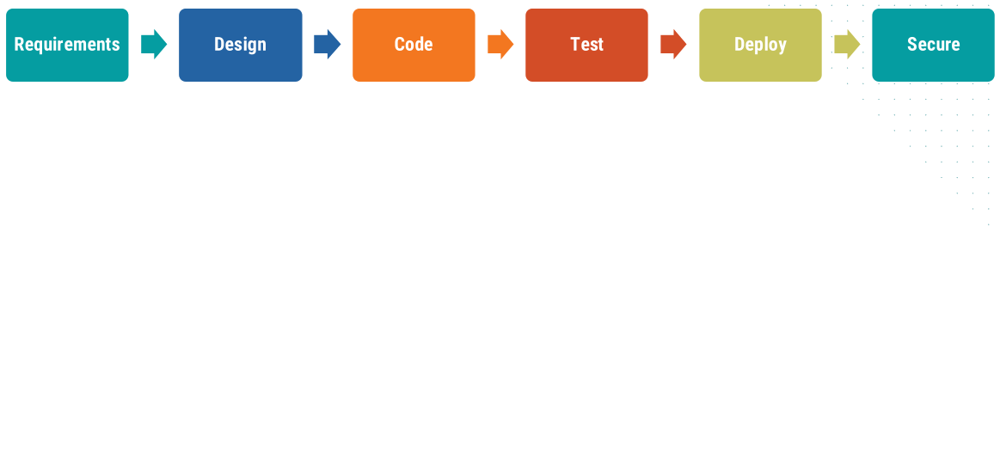

<style>
  :root {
    /* Slide background, code foreground
       Second color is used for class: invert */
    --color-background: light-dark(#f9f9f9, #0288d1);
  }
  .highlighted-line {
    display: block;
    background-color: #ffaa0040;
    margin: 0 -6px;
    padding: 0 6px;
  }

  section.col2 {
    columns: 2;
    display: block;

    h2 {
      column-span: all;
    }
    h3, h4 {
    break-before: column;
    }
  }

  section.pedagogy {
    --color-background: #f9b0b0;
    --color-foreground: #645a45;
  }
</style>

# Continuous Deployment
<!-- _class: lead -->

Automated, Repeatable Deploys

## Our Project

1. Managed with git
2. Running Docker containers
3. Orchestrated with Kubernetes
4. Tested in Gitlab
5. **Deployed with ArgoCD**
6. Monitored with Prometheus and Grafana

## DevSecOps: _Shift Left_



<!--
Recall discussion of DevSecOps: Old plan, execute, reflect
doesn't work in modern high-tempo environment.
-->

## DevSecOps: _Shift Left_

<!-- _paginate: hold -->


<!--
So, we need to _shift left_ pre-release activities to occur throughout development.

Today, we're looking at testing.
- We want to do it throughout coding phase (at least).
- We need a quick feedback for developers.
=> Need automated testing
-->

## Continuous Delivery and Deployment

Three related terms for continuous software development:

- **Continuous Integration (CI):** Developer changes are continuously integrated merged into _main_ branch
- **Continuous Delivery (CD):** The _main_ branch is always in a state ready to be deployed
- **Continuous Deployment (CD):** The _main_ branch is automatically deployed when changes land

## Continuous Delivery is Mostly Culture

For _main_ to be deployable, all team members must cooperate

- Trunk-based development with small, frequent changes ensure changes reach main quickly, deltas between releases small
- Extensive testing gives confidence in frequent releases
- Failing tests on _main_ is an emergency
- Backwards compatibility makes deploys easier; allows rollbacks

## Continuous Deployment Requires Tooling

Same culture as for continuous delivery, but even more strict
&rarr; No human in the loop to stop a bad deployment

Also need tooling to run deployments automatically

Recall first devsecops principle: **Repeatability and automation**

## CD Continuum

The deployment automation necessary for continuous deployment is useful even when deployments are not triggered automatically

- Automated processes are repeatable, ensuring that deployments work every time
- Automated processes are easier, making a team practicing continuous delivery willing to deploy more often
- Builds confidence for eventual transition to continuous deployment

<!--
We use continuous delivery for our technical curriculum.  But the
deployment process is completely automated: We just bump a version
number in a configuration file, and a new version of the curriculum gets deployed.  Deployment has become "boring".
-->

## First Step: Deploying the Docker Image

- Already building the _web-service_ docker image in CI
- If tests pass, we should publish it
- Docker images often stored in a **container registry**

## Container Registries

We have already been pulling images from several public registries:
- Docker Hub for the _ollama_ container
- GitHub Container Registry for the _uv_ container

GitLab provides a container registry for each project
&rarr; See _Deploy_ ❭ _Container registry_
&rarr; Available at **registry.gitlab.com/_username_/_project_**

## Deploying a Docker Image

Docker images are deployed by tagging with the full registry
```bash
# Tag at build time
docker build ... -t registry.gitlab.com/user/project/image:tag

# Or add a tag to an existing image
docker tag local:latest registry.gitlab.com/user/project/image:tag
```

Then push the the image to the registry:
```bash
docker push registry.gitlab.com/user/project/image:tag
```

## Authentication and Container Registries

Authenticate with a container registry with the _login_ command:
```bash
docker login registry.gitlab.com
```

Authentication is necessary to push to registry, may be necessary to pull from registry

GitLab container registries share project permissions, by default

See _Settings_ ❭ _General_ ❭ _Visibility, project features, permissions_

<!--
For our demonstration, it will be easier to have a public repository and a public container registry.
-->

## When to Push an Image

We have decided to push images:

- Only when tests are passing
- Only from the _main_ branch
  - These are the ones that could be deployed
- Only when the image has actually changed
  - Identifying this can be tricky

<!--
Other choices may make sense.

You may want to push on test failure, to make it easier to debug.  (But you probably want to make sure such images are
never actually used in production!)

You may want to push images from other branches, so that they
can be used for testing on staging environments.

You might push every time, and rely on docker deduplication to
keep from filling your disk.  Or maybe the image is the only
thing in the repo, so it makes sense to push on each commit.
-->

## Identifying Images

- Want a way to identify images from their contents
  - We know when the image has changed
  - Can use this to tag the image

1. **Use the git sha.**  Picks up all changes to repository.
2. **Use docker image digest.** Not reproducible with default settings.
3. **Derive from image directory contents.**  Works if and only if rest of build process is reproducible.

## Deriving an ID from Directory Contents

The `git rev-parse` command generates a hash of file contents
```bash
git rev-parse HEAD:project/images/web-service
```

This will not be reproducible unless:
- The build process is reproducible
  - This is why we lock the versions of the packages we're using
- The base image is locked
  - It isn't now, but we will do that soon

## Calculate Image Tag During Build

Update the _build-image_ job in `.gitlab-ci.yml`:

```yaml {5,7-10}
build-image:
  # ...
  variables:
    DOCKER_TLS_CERTDIR: "/certs"
    IMAGE_NAME: $CI_REGISTRY_IMAGE/web-server
  script:
    - IMAGE_TAG=$IMAGE_NAME:$(git rev-parse HEAD:project/images/web-service)
    - echo "Building image ${IMAGE_TAG}"
    - docker build project/images/web-service -t $IMAGE_TAG
    - docker save -o web-service.tar $IMAGE_TAG
  # ...
```

## Calculate Image Tag During Build

<!-- _paginate: hold -->

```yaml {5}
build-image:
  # ...
  variables:
    DOCKER_TLS_CERTDIR: "/certs"
    IMAGE_NAME: $CI_REGISTRY_IMAGE/web-server
  script:
    - IMAGE_TAG=$IMAGE_NAME:$(git rev-parse HEAD:project/images/web-service)
    - echo "Building image ${IMAGE_TAG}"
    - docker build project/images/web-service -t $IMAGE_TAG
    - docker save -o web-service.tar $IMAGE_TAG
  # ...
```

`$CI_REGISTRY_NAME` provided automatically by GitLab CI/CD

## Calculate Image Tag During Build

<!-- _paginate: hold -->

```yaml {7}
build-image:
  # ...
  variables:
    DOCKER_TLS_CERTDIR: "/certs"
    IMAGE_NAME: $CI_REGISTRY_IMAGE/web-server
  script:
    - IMAGE_TAG=$IMAGE_NAME:$(git rev-parse HEAD:project/images/web-service)
    - echo "Building image ${IMAGE_TAG}"
    - docker build project/images/web-service -t $IMAGE_TAG
    - docker save -o web-service.tar $IMAGE_TAG
  # ...
```

Calculate image tag from directory contents

## Pass Image Tag to Later Job

Write file with environmental variables, to be loaded in later job

```yaml {5,10-11}
build-image:
  # ...
  script:
    - IMAGE_TAG=$IMAGE_NAME:$(git rev-parse HEAD:project/images/web-service)
    - echo "IMAGE_TAG=${IMAGE_TAG}" >> build.env
    - echo "Building image ${IMAGE_TAG}"
    # ...
  artifacts:
    # ...
    reports:
      dotenv: build.env
```

## Add a Deploy Stage

<!-- _class: col2-->

<style scoped>
  pre {
    font-size: 0.95em;
  }
</style>

```yaml {4,6-14}
stages:
  - test
  - build
  - deploy
# ...
deploy-image:
  stage: deploy
  dependencies:
    - build-image
  image: docker:27-cli
  services:
    - docker:27-dind
  rules:
    - if: $CI_COMMIT_BRANCH == "main"
```

###

Add a new stage, _deploy_ to run after the _build_ stage

The _deploy-image_ job is configured similarly to the _build-image_ job

## Add a Deploy Stage

<!-- _class: col2-->
<!-- _paginate: hold -->

<style scoped>
  pre {
    font-size: 0.95em;
  }
</style>

```yaml {8-9}
stages:
  - test
  - build
  - deploy
# ...
deploy-image:
  stage: deploy
  dependencies:
    - build-image
  image: docker:27-cli
  services:
    - docker:27-dind
  rules:
    - if: $CI_COMMIT_BRANCH == "main"
```

###

Marking this as a dependency of the _build-image_ job ensures the `$IMAGE_TAG` variable defined there will be inserted here

## Add a Deploy Stage

<!-- _class: col2-->
<!-- _paginate: hold -->

<style scoped>
  pre {
    font-size: 0.95em;
  }
</style>

```yaml {13-14}
stages:
  - test
  - build
  - deploy
# ...
deploy-image:
  stage: deploy
  dependencies:
    - build-image
  image: docker:27-cli
  services:
    - docker:27-dind
  rules:
    - if: $CI_COMMIT_BRANCH == "main"
```

###

Only run this job on the _main_ branch

## Push the Image to the Container Registry

```yaml
deploy-image:
  # ...
  before_script:
    - |
      echo "$CI_REGISTRY_PASSWORD" |
      docker login $CI_REGISTRY -u $CI_REGISTRY_USER --password-stdin
  script:
    - docker load -i web-service.tar
    - docker push $IMAGE_TAG
```

## Push the Image to the Container Registry

<!-- _paginate: hold-->

```yaml {5-6}
deploy-image:
  # ...
  before_script:
    - |
      echo "$CI_REGISTRY_PASSWORD" |
      docker login $CI_REGISTRY -u $CI_REGISTRY_USER --password-stdin
  script:
    - docker load -i web-service.tar
    - docker push $IMAGE_TAG
```

GitLab CI/CD provides ephemeral `$CI_REGISTRY_USER` and `$CI_REGISTRY_PASSWORD` for container registry access

## Push the Image to the Container Registry

<!-- _paginate: hold-->

```yaml {8-9}
deploy-image:
  # ...
  before_script:
    - |
      echo "$CI_REGISTRY_PASSWORD" |
      docker login $CI_REGISTRY -u $CI_REGISTRY_USER --password-stdin
  script:
    - docker load -i web-service.tar
    - docker push $IMAGE_TAG
```

Load the image built in _build-image_.  It's already tagged with the registry name, so we can push it.

## Activity: Kick off a Pipeline Run

<!-- _class: invert -->

1. Commit the changes to `.gitlab-ci.yml` to the _main_ branch
2. Push the changes to GitLab
3. Watch the Pipeline execute
   - It should have a _deploy_ stage
   - This should push the docker image to the registry
4. Copy the image tag from the output (we'll need it soon)
5. Check your project's container registry for an image

## Accessing Registries from within K8s

- Images in public registries can be referenced with their full path in the `image` value in K8s manifests
- To access images in a private registry:
  1. Create a _docker-registry_ Secret:
      ```bash
      kubectl create secret docker-registry mycreds --docker-server=mysrv \
        --docker-username=user --docker-password=pswd --docker-email=email
      ```
  2. In your pod spec, add `imagePullSecrets`:
      ```yaml
        imagePullSecrets:
          - name: mycreds
      ```

## Activity: Use Image from Registry

<!-- _class: invert -->

1. Edit `project/services/web-service.yaml`
    - Switch image from `web-container` to tag from CI output
    - Remove `imagePullPolicy: Never`
2. Deploy the new version of the _web-service_ with `kubectl apply -f web-service.yaml`
3. The _web-service_ pods should restart

## Automatically Update Image Tag

- When we deploy a new image, we want it to be used automatically
- Could tag image as _:latest_, reference that in manifest, but:
  1. K8s does not check for updated images, by default
  2. We wouldn't be able to roll back to old images
- Instead, create a new git commit to update the image tag _within the CI pipeline_

<!--
K8s will only check for new image versions on a pod lifecycle event, and it depends on the `imagePullPolicy`.  The default is `IfNotPresent`, so the node won't pick up updates once it gets an image.  Another option is `Always`, but this only triggers when pods are created or containers restart.
-->

## Modify the _deploy-image_ Job

Set up a (arbitrary) username and email for git

```yaml {7-9}
deploy-image:
  # ...
  before_script:
    - |
      echo "$CI_REGISTRY_PASSWORD" |
      docker login $CI_REGISTRY -u $CI_REGISTRY_USER --password-stdin

    - git config --global user.name "GitLab CI"
    - git config --global user.email "ci@gitlab.com"
```

<!--
The highlighting is messing up unless we have this blank line in there.  It doesn't show up in the compiled version, though it does in the VSCode extension preview.  Urgh.
-->

## Modify the _deploy-image_ Script

```yaml {5-6}
deploy-image:
  # ...
  script:
    - |
      sed -i "s|image: ${CI_REGISTRY_IMAGE}.*|image: ${IMAGE_TAG}|g" \
        project/services/web-service.yaml
    - git diff --quiet || TAG_CHANGED=true
    - |
      if [ "$TAG_CHANGED" = true ]; then
        echo "Changes to docker image.  Pushing new image."
        docker load -i web-service.tar
        docker push $IMAGE_TAG
        git add project/services/web-service.yaml
```
_&mdash;Continues&rarr;_

<!--
A bit of shell magic to update the image line.  It relies on the
$CI_REGISTRY_IMAGE not changing.  It might be better to use a
tool like `yq` that is designed to edit YAML
-->

## Modify the _deploy-image_ Script

<!-- _paginate: hold -->

```yaml
deploy-image:
  # ...
  script:
    - |
      sed -i "s|image: ${CI_REGISTRY_IMAGE}.*|image: ${IMAGE_TAG}|g" \
        project/services/web-service.yaml
    - git diff --quiet || TAG_CHANGED=true
    - |
      if [ "$TAG_CHANGED" = true ]; then
        echo "Changes to docker image.  Pushing new image."
        docker load -i web-service.tar
        docker push $IMAGE_TAG
        git add project/services/web-service.yaml
```
_&mdash;Continues&rarr;_

<!--
Highlighting isn't working.  Point out the TAG_CHANGED calculation and gate.
-->

## Modify the _deploy-image_ Script

<!-- _paginate: hold -->

```yaml {13}
deploy-image:
  # ...
  script:
    - |
      sed -i "s|image: ${CI_REGISTRY_IMAGE}.*|image: ${IMAGE_TAG}|g" \
        project/services/web-service.yaml
    - git diff --quiet || TAG_CHANGED=true
    - |
      if [ "$TAG_CHANGED" = true ]; then
        echo "Changes to docker image.  Pushing new image."
        docker load -i web-service.tar
        docker push $IMAGE_TAG
        git add project/services/web-service.yaml
```
_&mdash;Continues&rarr;_

<!--
Stage the changes
-->

## Modify the _deploy-image_ Script

_&larr;Continued&mdash;_
```yaml
        git commit -m "Update web-service image tag [skip ci]
      Now set to ${IMAGE_TAG}"
        git push https://...git HEAD:main
      else
        echo "Docker image unchanged."
      fi
```

The `[skip ci]` message tells GitLab CI to not trigger a pipeline for this commit
$\Rightarrow$ Avoid causing a loop

<!--
Make a commit message.  Weird way to get a new paragraph,
but it works.

Our logic should prevent a loop, but the [skip ci] tag is an
extra protection.
-->

## Modify the _deploy-image_ Script

<!-- _paginate: hold -->

_&larr;Continued&mdash;_
```yaml {3}
        git commit -m "Update web-service image tag [skip ci]
      Now set to ${IMAGE_TAG}"
        git push https://...git HEAD:main
      else
        echo "Docker image unchanged."
      fi
```

Full URL for _push_ command: `https://oauth2:${GITLAB_WRITE_TOKEN}@${CI_SERVER_HOST}/ ${CI_PROJECT_PATH}.git`

## Creating an Access Token

The CI script will need a GitLab Access Token in order to push to repo

1. Go to _Settings_ ❭ _Access tokens_ and click _Add new token_
2. Add a _Name_ and _Description_
3. Set the role to be _Maintainer_
4. Enable the _write_repository_ scope
5. Click _Create project access token_
6. Copy the access token string

<!--
The Maintainer role is necessary due to default protections on
the main branch.  Only Maintainers and Owners can push there, by
default.
-->

## Using the Access Token in the Pipeline

The access token must be made available in the `$GITLAB_WRITE_TOKEN` environmental variable

1. Go to _Settings_ ❭ _CI/CD_ ❭ _Variables_
2. Under _Project variables_, click _Add variable_
3. Set visibility to _Masked and hidden_
4. Set the _Key_ to be `GITLAB_WRITE_TOKEN`
5. Set the _Value_ to be the token copied above
6. Click _Add variable_

<!--
Masked is probably enough, but this is a power token.
-->

## Test the Pipeline

Commit the changed `.gitlab-ci.yml` file and push to GitLab

The pipeline should kick off

You may or may not get a commit editing the image tag, depending on how you had formatted that line by hand

If a new commit was created, pull it to your local repo with `git pull gitlab main`

## Activity: Switch Dockerfile to Use Digests

<!-- _class: invert -->

The `project/images/web-service/Dockerfile` uses tags for base images
&rarr; A change in that tag could change the resultant image

1. Get the SHA digests for the base images
    - For local image: `docker images --digests image:tag`
    - For remote image: `docker manifest inspect image:tag`
2. Adjust the Dockerfile to use the digest instead of the tag
    `FROM image@sha256:012...def`
3. Commit and push.  This will start a pipeline that builds a new image.
4. Pull the resultant commit: `git pull gitlab main`

## Deploying Updated K8s Manifests

We need to automatically deploy manifests when they change in _main_

Two general approaches:
1. **Push-based:** CI pipeline includes a deploy step
2. **Pull-based / GitOps:** Agent watches for changes in repo, reconciles system to desired state

##

<!-- _class: col2 -->

#### Pushed-based

Pipeline triggers deployment process

Procedural definition; may miss drift from manual changes

CI needs edit access to cluster

Failure shows up in pipeline

Pipeline plus CLI tools

#### GitOps

Controller reconciles repo with cluster state

Declarative definition; reverts manual changes

Cluster needs read access to CI

Need monitoring to detect failure

Special controller (_ArgoCD_, _Flux_)

## ArgoCD

**ArgoCD** is a GitOps continuous deployment tool for Kubernetes

- Git repositories act as source of truth
- Works with YAML manifests, Helm charts, and other formats
- Runs as a Kubernetes **controller**
  - Adjusts state of cluster to match that required by manifests
- Configure with web UI, CLI, or declarative YAML
- Can run in production cluster (**standalone**) or on a separate mangement cluster (**hub-and-spoke**)

##

<!-- _class: col2 -->

<style scoped>
li.pos {
  list-style-type: "✅ ";
}
li.neg {
  list-style-type: "🔴 ";
}
</style>

### Standalone

<ul>
<li class="pos">Simple to set up</li>
<li class="pos">No external access to API server</li>
<li class="neg">Powerful permissions inside production cluster
<li class="neg">Broken cluster cannot repair itself</li>
</ul>

### Hub and Spoke

<ul>
<li class="pos">Single resource can control all clusters</li>
<li class="pos">Can repair broken clusters</li>
<li class="neg">Contains credentials for all clusters</li>
<li class="neg">Single point of failure</li>
</ul>

<!--
We will deploy it standalone, mainly because it's simpler.
-->

## Point of Pedagogy

<!-- _class: pedagogy -->

We will be installing ArgoCD in our local development environment

This is _not_ standard practice&mdash;ArgoCD is used to deploy staging and production clusters

We are doing this only to have a place to play with ArgoCD&mdash;don't do this on real development environments

## Installing ArgoCD

```bash
# Create namespace
kubectl create namespace argocd
# Create resources
kubectl apply -n argocd --server-side --force-conflicts \
-f https://raw.githubusercontent.com/\
argoproj/argo-cd/stable/manifests/install.yaml
```

This [install.yaml](https://raw.githubusercontent.com/argoproj/argo-cd/stable/manifests/install.yaml) contains a number of K8s manifests
&rarr; This could be vendored in our git repository

`--server-side`: Avoid issues with large CRDs
`--force-conflicts`: Needed for upgrades

<!--
URL: https://raw.githubusercontent.com/argoproj/argo-cd/stable/manifests/install.yaml
-->

## Activity: What Did ArgoCD Install?

<!-- _class: invert -->

Use `kubectl` to look for pods, deployments, and services in the _argocd_ namespace

You may find `kubectl get all -n argocd` useful

## ArgoCD Core

The default installation includes many features beyond the basic GitOps tools

[ArgoCD Core](https://argo-cd.readthedocs.io/en/stable/operator-manual/core/) provides just enough to conduct GitOps

Consider using this on production systems, to decrease target area

## ArgoCD Web UI

The _argocd-server_ service is a web UI to ArgoCD

```bash
kubectl port-forward -n argocd services/argocd-server 8080:443
```

This server is speaking HTTPS.  To connect to it through the Codespaces proxy:
1. Go to _Ports_ tab in the Codespaces bottom pane
2. Right click on port 8080
3. Click _Change Port Protocol_ ❭ _HTTPS_

## Logging in to the Web UI

ArgoCD can support multiple users, each with different permissions

A default user named _admin_ has been created

The password is stored in a K8s Secret.  You can view it with the following:
```bash
kubectl -n argocd get secret argocd-initial-admin-secret \
  -o jsonpath='{.data.password}' | base64 -d
```

Log in with user _admin_

## ArgoCD Applications

ArgoCD deploys **Applications**

We'll make an Application that deploys the _web-server_ and _ollama_ services

Click _+ New App_ to create an Application

## Creating an Application, pt. 1

- The _Application Name_ needs to be a valid K8s identifier
  - We'll use `dso-application`
- _Project Name_ should be `default`
  - User permissions can be allocated per project
- In _Source_, set the _Repository URL_ to the HTTPS git from GitLab
  - This requires a public-visible project
  - ArgoCD can be set up to access private repositories
- Set _Path_ to `project/services`
  - This is the path in our repo containing the manifests

## Creating an Application, pt. 2
- In _Destination_, set _Cluster URL_ to `https://kubernetes.default.svc`
  - This refers to the cluster itself, as we're using standalone mode
- Set _Namespace_ to `dso-project`
- Click _Create_

The new Application should pick up all existing components defined in `project/services`, but is unlikely to be in sync
&rarr; State of cluster does not match specification in git
$\Rightarrow$ Press the _Sync_ button to synchronize the deployment with git

<!--
The lack of synchronization may be due to missing tags that
ArgoCD expects from its previous deploy
-->

## App Health

Ideally, the Application will be reported as _Healthy_

If the health is stuck in _Progressing_, it may be due to a service trying to use a LoadBalancer
&rarr; Minikube doesn't provide real load balancers, and Argo CD notices
$\Rightarrow$ Switch service type to _ClusterIP_

## Activity: Deploy a Change

<!-- _class: invert -->

1. Change the number of replicas in the _web-service_ Deployment
2. Push the changes to GitLab master
3. Within 3 minutes, ArgoCD should notice the change and report that the Application is not in sync
4. Synchronize the Application
5. Check that the number of pods for the _web-service_ has changed

<!--
ArgoCD waits 120s plus a random time from 0 - 60s before
checking for changes in git.  So it can take up to 3 minutes to notice new changes.
-->

## Configuration Mechanisms

How does the use of the Web UI align with DevSecOps principles?

1. Repeatability and automation
2. Configuration as code
3. Store configuration in version control
4. Declarative, not procedural
5. Livestock, not pets
6. Testing

## Configuration Mechanisms

<!-- _paginate: hold -->

How does the use of the Web UI align with DevSecOps principles?

1. ~~Repeatability and automation~~
2. ~~Configuration as code~~
3. ~~Store configuration in version control~~
4. ~~Declarative, not procedural~~
5. Livestock, not pets
6. Testing


## Declarative Configuration

Applications should be defined declaratively, in configuration files

Applications are tracked by Kubernetes:

```bash
kubectl get applications -n argocd
```

They are a **Custom Resource Definition (CRD)**
- Mechanism to define custom _kinds_ in Kubernetes
- A custom **controller** can use CRDs to understand what to deploy

<!--
See all CRDs with `kubectl get crd`
-->

## Extract Custom Resource Configuration

```bash
# Create a new folder
mkdir project/argocd
# Write Custom Resource manifest to disk
kubectl get applications -n argocd dso-application -o yaml > \
  project/argocd/apps.yaml
```

This file will contain state information that's unneeded in manifest
- Delete the entire `service` structure
- Delete all entries in `metadata`, except `name` and `namespace`

Resultant file should look like&hellip;

## Application Configuration

```yaml
apiVersion: argoproj.io/v1alpha1
kind: Application
metadata:
  name: dso-application
  namespace: argocd
spec:
  destination:
    namespace: dso-project
    server: https://kubernetes.default.svc
  project: default
  source:
    path: project/services
    repoURL: https://gitlab.com/pragdata/devsecops.git
    targetRevision: HEAD
```

<!--
Note: All pieces that we defined in the web UI
-->

## Edit Applications with `kubectl`

Now, applications can be created and edited with `kubectl apply`:

```bash
kubectl apply -f project/arcocd/apps.yaml
```

This will likley give a warning about a missing _last-applied-configuration_ annotation
&rarr; This should only happen the first time, and only because we created this Application through the Web UI first

## ArgoCD can Synchronize Automatically

```yaml
spec:
  # ...
  syncPolicy:
    automated:
      enabled: true
```

Additional options:
`prune: true`: Delete resources no longer defined in git
`allowEmpty: true`: Allow application with empty resoruces
`selfHeal: true`: Overwrite manual changes to cluster state

## Activity: Trigger an Automated Sync

<!-- _class: invert -->

1. Apply the Application with automated synchronization
2. Change the number of replicas in the _web-service_ Deployment
3. Push this change to GitLab
4. In several minutes, ArgoCD should notice the change, synchronize the cluster, and change the number of _web-service_ pods

## Namespace Confusion

Currently specifying namespace in Argocd and resource manifests
&rarr; Likely confusion if they were to differ

Best practice: Specify namespace only in ArgoCD

## ArgoCD Manages Namespaces

1. Remove _dso-project_ namespace definition from `web-service.yaml`
2. Remove namespace from metadata for all resources in `web-service.yaml` and `ollama.yaml`
3. Let ArgoCD create namespace if needed
    ```yaml
    spec:
      # ...
      syncPolicy:
        # ...
        syncOptions:
          - CreateNamespace=true
    ```

## A Pedagogical Annoyance

<!-- _class: pedagogy -->

- Once these changes are deployed, ArgoCD won't fully synchronize
  - ArgoCD sees that namespace no longer defined in git
  - Namespace still exists (unless pruning turned on)
- Trigger a manual sync, enabling pruning
  - The entire _dso-project_ namespace is deleted
  - We are not properly synced
- Manually synchronizing again should fix everything

This is all because we are converting the existing resources, instead of starting from scratch

<!--
Note the power of declarative configuration: We deleted _everything_, and we were able to get it back without a sweat.

We could have done this more smoothly:
First, annotate the namespace as not being prunable:
```bash
metadata:
  name: your-namespace
  annotations:
    argocd.argoproj.io/sync-options: Prune=false
```
Deploy this version.

Then, delete the namespace manifest entirely and deploy.  ArgoCD notices it's missing, but since it's not prunable, it doesn't care.
-->

## Helm Applications

ArgoCD can deploy Kubernetes resources defined as
- Kubernetes manifests
- Helm charts
- Kustomize applications
- OCI images

For a Helm chart, specify location of chart and values file

## Create an Application for Garage

Add a new YAML document to `project/argocd/apps.yaml`

```yaml
---
apiVersion: argoproj.io/v1alpha1
kind: Application
metadata:
  name: garage
  namespace: argocd
spec:
  project: default
```

<!--
This is basically the same as we saw before, just with a different name.
-->

## Create an Application for Garage

```yaml
spec:
  # ...
  sources:
    - repoURL: https://datahub-local.github.io/garage-helm
      chart: garage
      targetRevision: 0.8.0
      helm:
        valueFiles:
          - $values/project/helm/garage.yaml
    - repoURL: https://gitlab.com/pragdata/devsecops.git
      targetRevision: HEAD
      ref: values
```

<!--
Here's the new stuff.
-->

## Create an Application for Garage

<!-- _paginate: hold -->

```yaml {3}
spec:
  # ...
  sources:
    - repoURL: https://datahub-local.github.io/garage-helm
      chart: garage
      targetRevision: 0.8.0
      helm:
        valueFiles:
          - $values/project/helm/garage.yaml
    - repoURL: https://gitlab.com/pragdata/devsecops.git
      targetRevision: HEAD
      ref: values
```

Multiple sources for this Application

## Create an Application for Garage

<!-- _paginate: hold -->

```yaml {4-9}
spec:
  # ...
  sources:
    - repoURL: https://datahub-local.github.io/garage-helm
      chart: garage
      targetRevision: 0.8.0
      helm:
        valueFiles:
          - $values/project/helm/garage.yaml
    - repoURL: https://gitlab.com/pragdata/devsecops.git
      targetRevision: HEAD
      ref: values
```

The chart is defined in the Helm repository

## Create an Application for Garage

<!-- _paginate: hold -->

```yaml {10-12}
spec:
  # ...
  sources:
    - repoURL: https://datahub-local.github.io/garage-helm
      chart: garage
      targetRevision: 0.8.0
      helm:
        valueFiles:
          - $values/project/helm/garage.yaml
    - repoURL: https://gitlab.com/pragdata/devsecops.git
      targetRevision: HEAD
      ref: values
```

The _values_ file is stored in our git repository

## Create an Application for Garage

<!-- _paginate: hold -->

```yaml {10}
spec:
  # ...
  sources:
    - repoURL: https://datahub-local.github.io/garage-helm
      chart: garage
      targetRevision: 0.8.0
      helm:
        valueFiles:
          - $values/project/helm/garage.yaml
    - repoURL: https://gitlab.com/pragdata/devsecops.git
      targetRevision: HEAD
      ref: values
```

Update the URL to match your GitLab repository

## Create an Application for Garage

<!-- _paginate: hold -->

```yaml {9,12}
spec:
  # ...
  sources:
    - repoURL: https://datahub-local.github.io/garage-helm
      chart: garage
      targetRevision: 0.8.0
      helm:
        valueFiles:
          - $values/project/helm/garage.yaml
    - repoURL: https://gitlab.com/pragdata/devsecops.git
      targetRevision: HEAD
      ref: values
```

A reference to the _values_ repository in the _valueFiles_ for the chart

## Create an Application for Garage

```yaml
spec:
  # ...
  destination:
    namespace: garage
    server: https://kubernetes.default.svc
  syncPolicy:
    automated:
      enabled: true
    syncOptions:
      - CreateNamespace=true
```

Apply this updated manifest to create a new Application

<!--
The rest is similar to before, but with a different destination.namespace

There may be some annoyances with getting things synced, as ArgoCD tries to reconcile the existing components.
-->

## Deploying Only After Tests Pass

With pushed-based CD, deployment can be gated on tests passing

With GitOps CD, need tests to pass before changes merged
- Be careful and only merge to main when tests pass on branch
- Only write change to manifest (eg new image) once tests pass
- Have a deployment repo, push changes there once tests pass
- Have a deployment branch, merge there once tests pass

## Rollbacks

ArgoCD tracks the last 10 synchronizations for each application

Can rollback to a previous state with the Web UI or CLI

**Beware:** If automatic synchronization enabled, ArgoCD will notice discrepancy and re-sync to git HEAD

**GitOps Solution:** Revert the problematic commit and deploy again
$\Rightarrow$ Keep all actions in git history

<!--
10 syncs is default; can be changed per application
-->

## Rollouts

- By default, ArgoCD uses native K8s rolling updates
  - Pods are gradually restarted with the new configuration
  - Ensures level of service throughout rollout
- More rollout strategies provided by [Argo Rollouts](https://argoproj.github.io/rollouts/)
  - **Blue-green deployments:** Run two instances in parallel
    - Test new deployment before switching production traffic
    - Instant rollback to previous deployment
  - **Canary deployments:** Gradually shift traffic to new deployment
    - Monitor health metrics before taking next step

## Activity: Stand Up New Cluster

<!-- _class: invert -->

1. Push all changes to GitHub
2. Start a new Codespace
3. Start minikube
4. Install ArgoCD
5. Install our applications

<!--
minikube start
kubectl create namespace argocd
kubectl apply -n argocd --server-side --force-conflicts -f https://raw.githubusercontent.com/argoproj/argo-cd/stable/manifests/install.yaml
kubectl apply -f projects/argocd/apps.yaml
-->

## Future Activity: Capstone Project

<!-- _class: invert -->

In the coming Capstone session, we'll be working through a scenario using these tools.

Some of you will need to drive configuration changes through review, merge, and deployment.  We will need your GitLab usernames to add you to the project.

It may prove useful for you to be able to share your screen.
