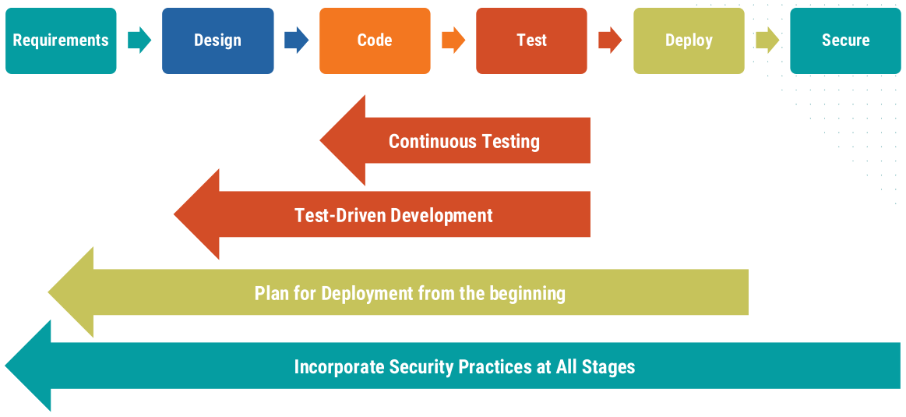
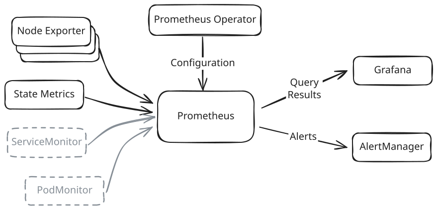

<style>
  :root {
    /* Slide background, code foreground
       Second color is used for class: invert */
    --color-background: light-dark(#f9f9f9, #0288d1);
  }
  .highlighted-line {
    display: block;
    background-color: #ffaa0040;
    margin: 0 -6px;
    padding: 0 6px;
  }

  section.col2 {
    columns: 2;
    display: block;

    h2 {
      column-span: all;
    }
    h3, h4 {
    break-before: column;
    }
  }

  section.pedagogy {
    --color-background: #f9b0b0;
    --color-foreground: #645a45;
  }
</style>

# Monitoring
<!-- _class: lead -->

What's Going On?

## Our Project

1. Managed with git
2. Running Docker containers
3. Orchestrated with Kubernetes
4. Tested in Gitlab
5. Deployed with ArgoCD
6. **Monitored with Prometheus and Grafana**

## DevSecOps: _Shift Left_



<!--
We've mostly been talking about bringing ops issues into development.  But the other half if that developers need to take over traditional ops roles: monitor and maintain the system.
-->

## Importance of Monitoring

Even when a system works in testing, the real world can change

- User behavior changes
- External services change their behavior
- External services break or disappear
- Hardware fails
- Disk space is exhausted

We need to know what is actually happening

## Prometheus and Grafana

<!-- Standard tools for monitoring Kubernetes clusters and applications: -->

**Prometheus** is a time-series database
- Periodically injests data from a source
- Stores the data
- Runs queries on this data

**Grafana** is an analytics and visualization web application
- Queries a wide variety of databases (including Prometheus)
- Displays selected metrics in dashboards

## Note: _minikube_ Won't Run This Well

<!-- _class: pedagogy -->

Our minikube clusters don't have enough resources to run all of these components well

I will demonstrate on a real Kubernetes cluster

You will have access to this cluster during the capstone project

<!--
I can't ask you to do exercises here.  But I will ask you to tell me what to do in certain situations.
-->

## Installing a Monitoring Stack

Several components will need to be installed and configured to work together

The [kube-prometheus project](https://github.com/prometheus-operator/kube-prometheus) collects and configures these components into a working solution

It can be installed from a [collection of YAML manifests](https://prometheus-operator.dev/docs/getting-started/installation/#install-using-yaml-files) or a [community helm chart](https://github.com/prometheus-community/helm-charts/tree/main/charts/kube-prometheus-stack)

<!--
A slightly different approach than what we've done in the past -- we're going to install everything and then see what happened.
-->

## Installing From the Helm Chart

```bash
helm install prometheus \
  oci://ghcr.io/prometheus-community/charts/kube-prometheus-stack \
  --namespace monitoring --create-namespace
```

The `oci://` scheme indicates that the chart is stored in an OCI-compliant registry
<small>&rarr; "Open Container Initiative" is the vendor-neutral way to say "Docker"</small>

This will take a minute or two to complete

## Activity: What Got Installed?

<!-- _class: invert -->

How can we check what got installed?
- Pods
- Deployments
- Services
- _others?_

<!--
```bash
kubectl get all -n monitoring
```
-->

## Prometheus Sits at the Heart

Prometheus is running in the _prometheus-kube-prometheus-prometheus_ service

It exposes a web UI on port 9090:

```bash
kubectl port-forward -n monitoring \
  service/prometheus-kube-prometheus-prometheus 9090
```

## Prometheus Web UI

The web UI lets us query the time-series database

One metrics being tracked is _node_memory_MemAvailable_bytes_
&rarr; Enter this in the _Expression_ box and press _Execute_

The _Table_ interface shows the current value of this metric

There are three numbers, one for each node in our cluster
&rarr; Note the _instance_ property is different for each

The _Evaluation time_ widget shows values at different points in time

<!--
A quick run though some things.  We'll mainly use the Grafana interface
-->

## Graphing a Time Series

Switch to the _Graph_ interface to see these values change over time

Since Prometheus has just started up, there is rather limited range of times available right now

## Calculated Values

Change the _Expression_ to `node_memory_MemAvailable_bytes / node_memory_MemTotal_bytes`

Now the plot shows the fraction of memory free on each node

A wide variety of [operations](https://prometheus.io/docs/prometheus/latest/querying/operators/) is available

## Filtering Series

Change the expression to `container_cpu_usage_seconds_total`
This shows the total number of CPU-seconds used by each container

Each series has a number of labels.  We can filter on those labels by including an expression in curly braces:
```
container_cpu_usage_seconds_total{namespace='dso-project',
  container='web-container'}
```
$\Rightarrow$ Shows only containers named _web-container_ in _dso-project_ namespace

## Examining Rates

The rate at which the total CPU usage is changing tells us how much CPU is being used at any point in time

```
rate(container_cpu_usage_seconds_total{namespace='dso-project',
  container='web-container'}[1m])
```

`rate` is a [function](https://prometheus.io/docs/prometheus/latest/querying/functions/) provided by Prometheus
`[1m]` indicates the rate is calculated over one-minute segments

<!--
We won't dive more into Prometheus queries here.  Grafana will let us assemble them more easily.
-->

## Six Installed  Workloads

- _prometheus-prometheus-kube-prometheus-prometheus_
  - StatefulSet running Prometheus
  - Stores the time-series database
  - Ingests data from various sources
  - Runs queries on the database

- _prometheus-kube-prometheus-operator_
  - Deployment running the [Prometheus Operator](https://prometheus-operator.dev/)
  - Watches for custom resources representing Prometheus configs
  - Updates Prometheus when custom resources change

## Six Installed Workloads
- _prometheus-prometheus-node-exporter_
  - DaemonSet runs one pod per node
  - Gathers node metrics for Prometheus to collect

- _prometheus-kube-state-metrics_
  - Deployment of pod to talk to K8s API server
  - Gathers metrics on cluster state (pods, nodes, PVCs, _etc_)

## Six Installed Workloads

- _alertmanager-prometheus-kube-prometheus-alertmanager_
  - StatefulSet running the [Prometheus AlertManager](https://prometheus.io/docs/alerting/latest/alertmanager/)
  - Receives alerts from Prometheus
  - Deduplicates, groups, silences alerts as appropriate
  - Routes alters to specified receivers
- _prometheus-grafana_
  - Deployment of Grafana
  - Web UI for exploration and dashboarding

## Architecture



## Running Services Outside the Cluster

<!-- _class: col2 -->

<style scoped>
li.pos {
  list-style-type: "✅ ";
}
li.neg {
  list-style-type: "🔴 ";
}
</style>

#### Prometheus
<ul>
<li class="pos">Survives cluster crash</li>
<li class="neg">Need to route all metrics providers</li>
<li class="neg">Service account outside cluster</li>
<li class="neg">Can't configure with Operator</li>
<li>Less common</li>
</ul>


#### Grafana
<ul>
<li class="pos">Connect to many sources</li>
<li class="pos">Managed options</li>
<li class="pos">Easier persistence</li>
<li class="neg">Need to expose Prometheus</li>
<li class="neg">Can't configure with ConfigMaps</li>
<li>Somewhat common</li>
</ul>

## Visualizing Data with Grafana

Grafana sits behind a login.  Get the default password:
```bash
kubectl get secret -n monitoring prometheus-grafana \
  -o jsonpath="{.data.admin-password}" | base64 -d; echo
```

Set up port forwarding:
```bash
kubectl port-forward -n monitoring service/prometheus-grafana 8088:80
```

Login in with username _admin_ and password from above

<!--
Note on ports: will say forwarding to port 3000.  This is port in pod (container?), not service.  A bit weird, but these abstractions leak occasionally
-->

## Explore Prometheus Data in Grafana

Click _Explore_ in the left sidebar

In _Metric_, enter `container_cpu_usage_seconds_total`

Click _Run query_ to see graph and raw results

Add _Label filters_
- Set _namespace_ to `dso-project`
- Set _container_ to `web-container`

## Explore Data Rate

There should be a hint saying _add rate_
Click it and  select a _range_ of `1m`

Re-run the query to see the updated plot

Note that the Prometheus query is displayed
$\Rightarrow$ Can be edited directly by switching from _Builder_ to _Code_

## Create a Dashboard

1. Click _Add_ ❭ _Add to Dashboard_
2. Select _New dashboard_, then click _Open dashboard_
3. Click _Save_
4. Enter a title and click _Save_

## Edit the Dashboard

1. Click _Edit_
2. Below the exisitng panel, click _Add panel_
3. Click _Configure visualization_
4. Switch to _Code_ mode and enter `node_memory_MemAvailable_bytes / node_memory_MemTotal_bytes`
5. Click _Run queries_ to see a plot
6. In right-hand pane, scroll down and select a _Gauge_, for example
7. Adjust _Standard options_ ❭ _Min_ and _Max_ to `0` and `1`
8. Click _Save_, add a commit message, click _Save_

## Explore Existing Dashboards

Click _Dashboards_ in the left-hand pane to see all installed dashboards

For example _Kubernetes / Compute Resources / Namespace (Workloads)_ shows resources used by different workloads
&rarr; Change the _namespace_ selector to select those workloads

These dashboards show off the metrics being collected from K8s

Your dashboard also shows up in this list

## Persisting Dashboards

By default in this deploy, Grafana has no persistence
$\Rightarrow$ Custom dashboards will disappear when pod restarts

We could add a PVC to store changes

Better GitOps solution: Store dashboards as K8s resources

## Get Dashboard Code

1. Open the dashboard in Grafana
2. In the right bar, click _Export_ ❭ _Export as code_
3. Download or copy the file

## Create the Resource

Grafana loads dashboards from specially configured ConfigMaps
$\Rightarrow$ Create `monitoring/prometheus.yaml` with the following:

```yaml
apiVersion: v1
kind: ConfigMap
metadata:
  name: my-dashboard
  namespace: monitoring
  labels:
    grafana_dashboard: "1"
data:
  my-dashboard.json: |
    ...
```

## Create the Resource

<!-- _paginate: hold -->

```yaml {5}
apiVersion: v1
kind: ConfigMap
metadata:
  name: my-dashboard
  namespace: monitoring
  labels:
    grafana_dashboard: "1"
data:
  my-dashboard.json: |
    ...
```

Grafana will find dashboards in any namespace, by default

## Create the Resource

<!-- _paginate: hold -->

```yaml {6-7}
apiVersion: v1
kind: ConfigMap
metadata:
  name: my-dashboard
  namespace: monitoring
  labels:
    grafana_dashboard: "1"
data:
  my-dashboard.json: |
    ...
```

Grafana looks for this label to find dashboards

## Create the Resource

<!-- _paginate: hold -->

```yaml {10}
apiVersion: v1
kind: ConfigMap
metadata:
  name: my-dashboard
  namespace: monitoring
  labels:
    grafana_dashboard: "1"
data:
  my-dashboard.json: |
    ...
```

Paste the dashboard code here.  Make sure it's properly indented.

## Activity: Testing the ConfigMap

<!-- _class: invert -->

How do we:
1. Get this installed on the cluster?
2. Check that it persists?

<!--
1. kubectl apply -f monitoring/prometheus.yaml
2. Delete the grafana pod, log into the new one, and see if the dashboard is still there.
-->

## Persisting Prometheus Database

The default deploy does not include any persistence for the Prometheus database
$\Rightarrow$ A problem that causes Prometheus to restart will delete the data we need to debug it

We will set up a PVC to persist the database.

This can be configured through the helm values file

## Prometheus PVC

Create `helm/prometheus.yaml` with the following contents:

```yaml
prometheus:
  prometheusSpec:
    retention: 15d
    retentionSize: 45GB
    storageSpec:
      volumeClaimTemplate:
        spec:
          accessModes: ["ReadWriteOnce"]
          resources:
            requests:
              storage: 50Gi
```

## Prometheus PVC

<!-- _pageinate: hold -->

```yaml {4,11}
prometheus:
  prometheusSpec:
    retention: 15d
    retentionSize: 45GB
    storageSpec:
      volumeClaimTemplate:
        spec:
          accessModes: ["ReadWriteOnce"]
          resources:
            requests:
              storage: 50Gi
```
Rule of thumb: Make the _retentionSize_ 90% of the PVC size

## Upgrade the Prometheus Release

```bash
helm upgrade -n monitoring prometheus \
  oci://ghcr.io/prometheus-community/charts/kube-prometheus-stack \
  -f helm/prometheus.yaml
```

As before, this will take a few minutes

After Prometheus restarts, past data will have been lost

Data will not be lost on future restarts

## Adding Metrics to Prometheus

Prometheus gathers metrics by hitting various HTTP endpoints
&rarr; These must serve a particular [text-based format](https://o11y.eu/blog/prometheus-text-format/)

Many projects already expose metrics in this format

## Metrics from Garage

The _garage_ service exposes Prometheus metrics on port 3903

We can see them by forwarding the port:
```bash
kubectl port-forward -n garage service/garage 3903
```
and accessing http://localhost:3903


## ServiceMonitors and PodMonitors

The K8s Prometheus Operator watches for **ServiceMonitors** and **PodMonitors** to find metrics being provided by services and pods

When these resources are created, it adds the sources to Prometheus

## Service Monitor For Garage

Create `monitoring/garage.yaml`:

```yaml
apiVersion: monitoring.coreos.com/v1
kind: ServiceMonitor
metadata:
  name: garage
  namespace: garage
  labels:
    release: prometheus
spec:
  # ...
```
_&mdash;Continues&rarr;_

## Service Monitor For Garage

<!-- _paginate: hold -->

Needs to match Prometheus settings (this is the default value)

```yaml {6-7}
apiVersion: monitoring.coreos.com/v1
kind: ServiceMonitor
metadata:
  name: garage
  namespace: garage
  labels:
    release: prometheus
spec:
  # ...
```
_&mdash;Continues&rarr;_

## Service Monitor For Garage

<!-- _paginate: hold -->

Look for services in this namespace

```yaml {5}
apiVersion: monitoring.coreos.com/v1
kind: ServiceMonitor
metadata:
  name: garage
  namespace: garage
  labels:
    release: prometheus
spec:
  # ...
```
_&mdash;Continues&rarr;_

## Service Monitor For Garage

_&larr;Continued&mdash;_
```yaml
spec:
  selector:
    matchLabels:
      app.kubernetes.io/name: garage
  endpoints:
    - targetPort: 3903
      path: /metrics
      interval: 30s
      scrapeTimeout: 10s
```

## Service Monitor For Garage

<!-- _paginate: hold -->

_&larr;Continued&mdash;_
```yaml {3-4}
spec:
  selector:
    matchLabels:
      app.kubernetes.io/name: garage
  endpoints:
    - targetPort: 3903
      path: /metrics
      interval: 30s
      scrapeTimeout: 10s
```

Look for all services in the namespace with these labels

## Service Monitor For Garage

<!-- _paginate: hold -->

_&larr;Continued&mdash;_
```yaml {6-7}
spec:
  selector:
    matchLabels:
      app.kubernetes.io/name: garage
  endpoints:
    - targetPort: 3903
      path: /metrics
      interval: 30s
      scrapeTimeout: 10s
```

Path and port where the metrics are served

## Adding the Garage Metrics

Create the ServiceMonitor:

```bash
kubectl apply -f monitoring/garage.yaml
```

In Grafana's _Explore_ page, metrics like `garage_local_disk_available` should now appear

## Monitoring Container Logs

This setup only tracks numerical metrics

Container logs can be useful in understanding causes

[Grafana Loki](https://grafana.com/oss/loki/) ingests and stores text logs

These can be exposed and analyzed in Grafana

## Alerting

This stack provides two alerting systems:

The Prometheus **AlertManager** is configured by two CRDs:
- **PrometheusRules** define what triggers an alert
- **AlertmanagerConfigs** define how these alerts are routed

Grafana has its own copy of AlertManager embedded within it
- See the _Alterting_ page
- Prometheus alerts can be used as sources here

<!--
Generally, use Prometheus for pure K8s alerting.  Grafana for considering other datasources (Loki, SQL DB, ...) or for graphical UI (but need persistence)
-->

## Activity: Deploy Prometheus via ArgoCD

<!-- _class: invert -->

- Remove namespaces from the manifests
- Add monoitoring/garage.yaml to garage application
- Add prometheus application
